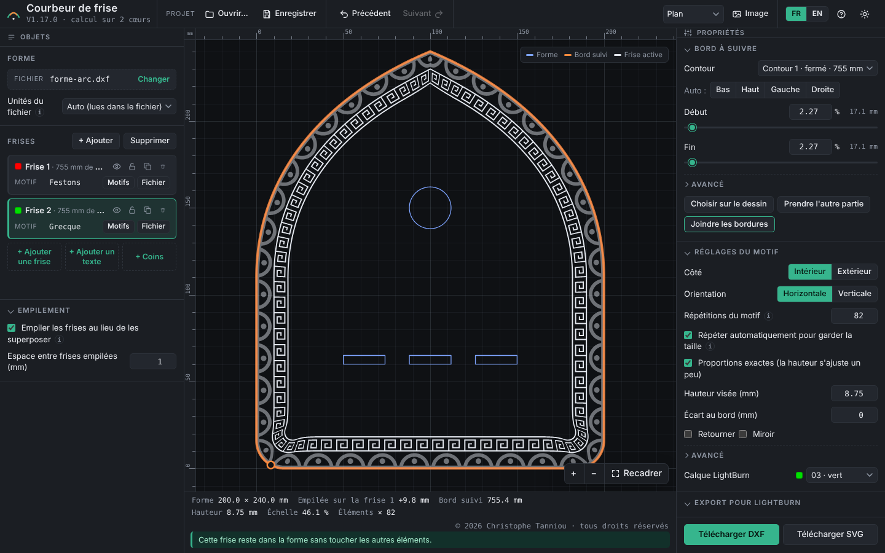
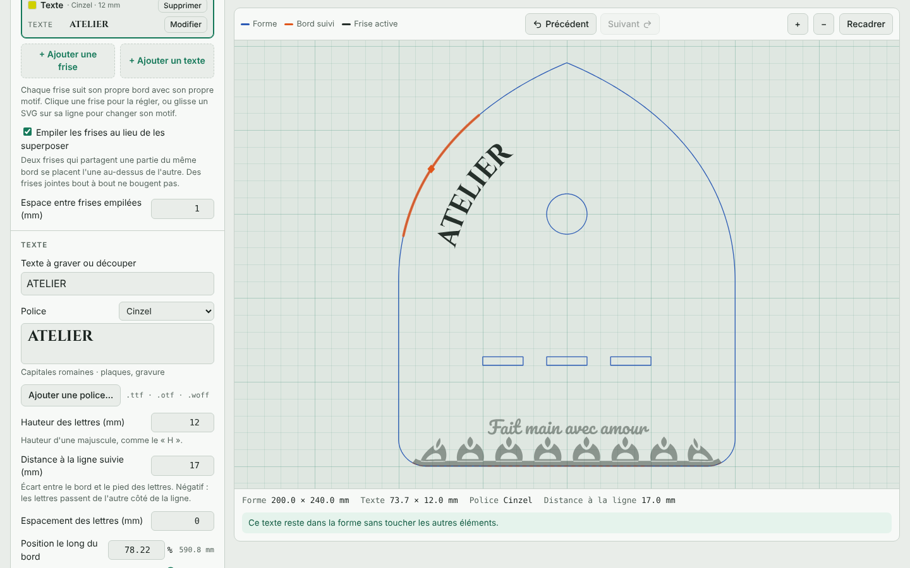
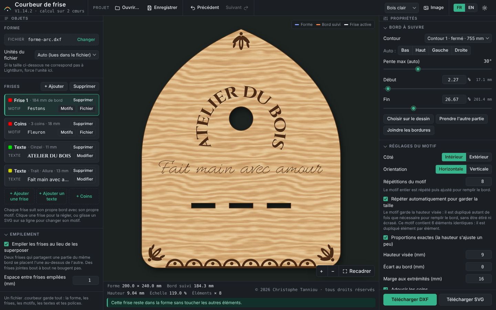
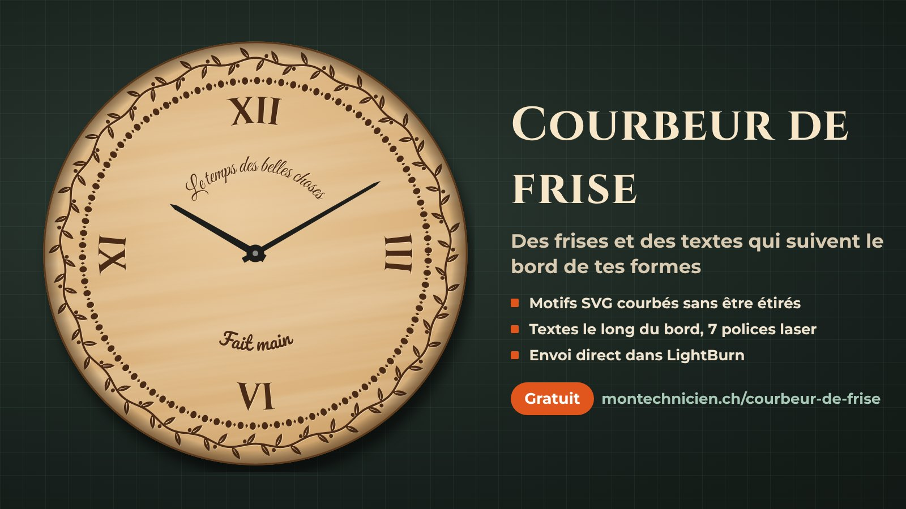
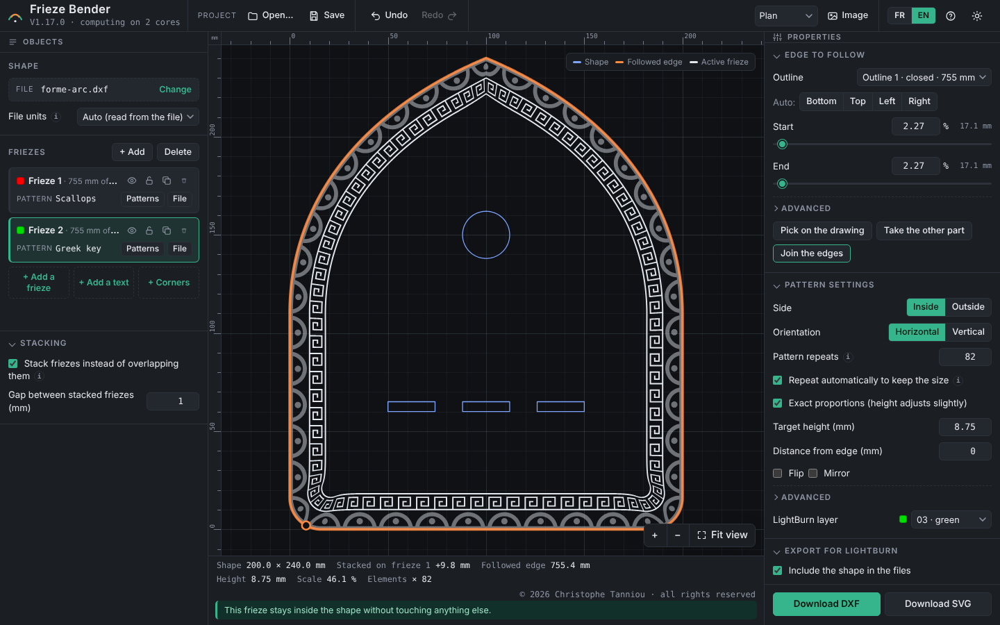
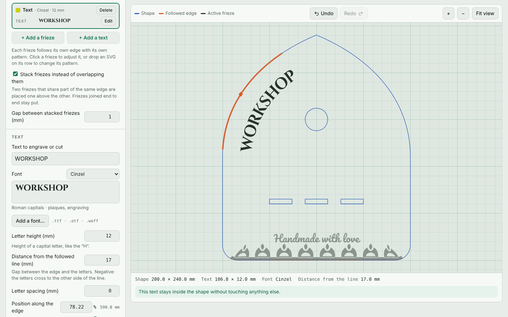
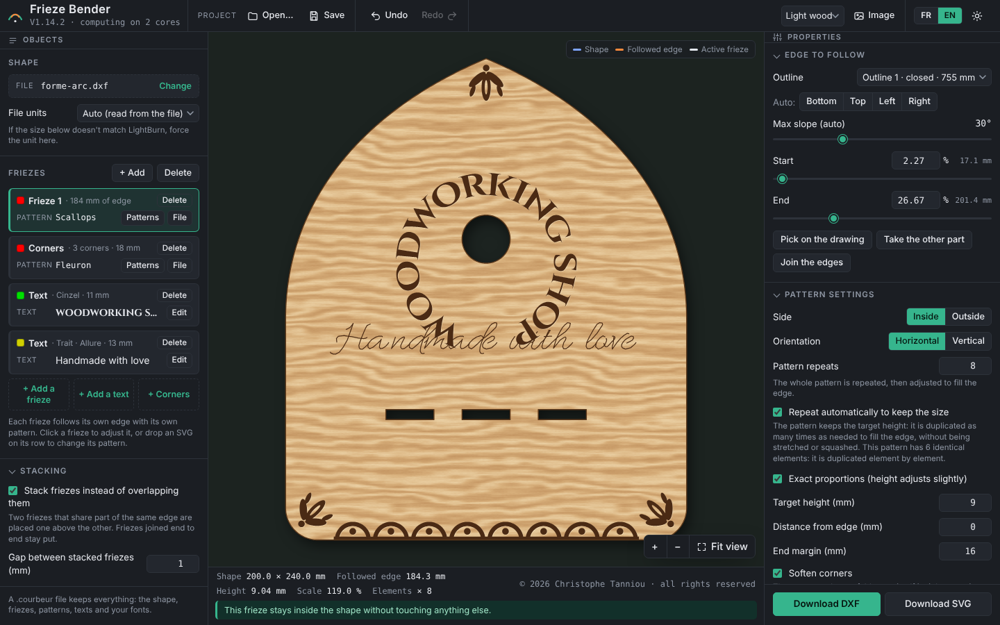
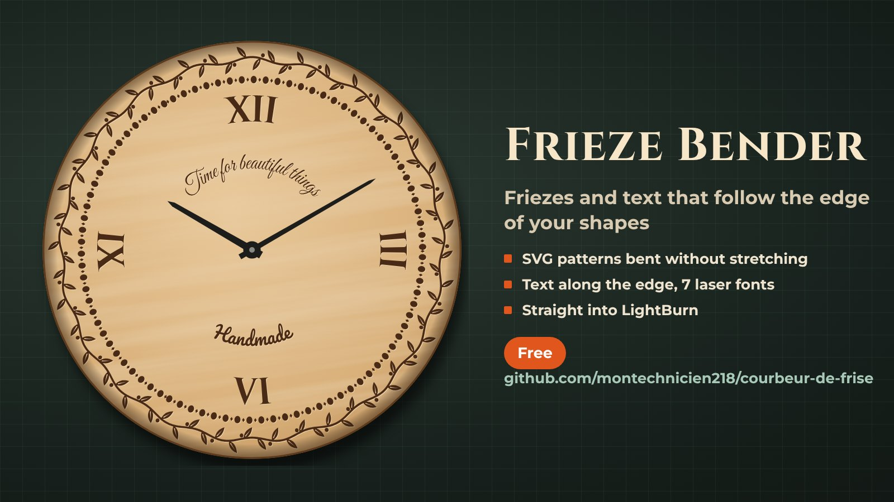
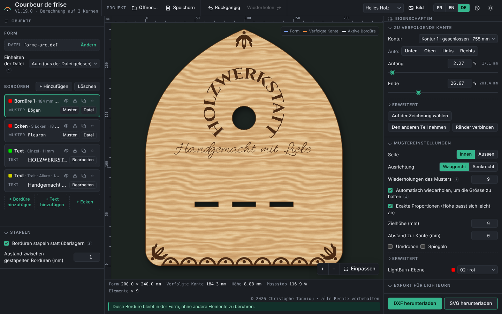
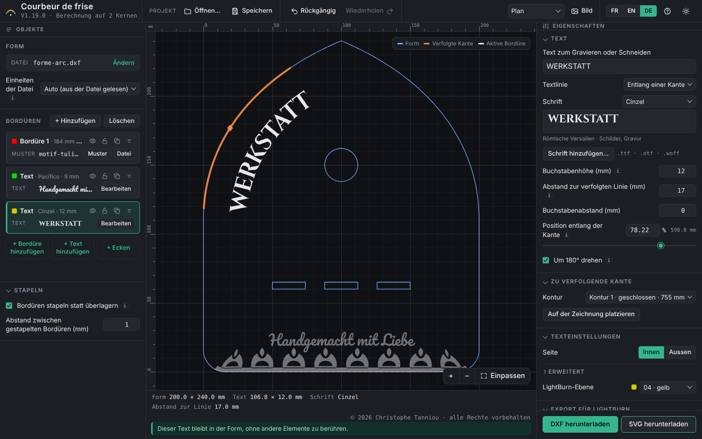

# Courbeur de frise · Frieze Bender

[Français](#français) · [English](#english) · [Deutsch](#deutsch)



---

## Français

Le **Courbeur de frise** fait suivre un motif SVG (une frise) le long d'un bord de ta forme DXF ou SVG, puis envoie le résultat à **LightBurn** pour la découpe ou la gravure laser. LightBurn ne sait pas courber un motif le long d'une courbe : cet outil le fait, en gardant la taille et la qualité du motif.

**Essayer sans rien installer :** [version web](https://montechnicien218.github.io/courbeur-de-frise/), sans envoi direct à LightBurn ni dossiers d'échange.

### Ce qu'il fait

- Courbe le motif le long de n'importe quel bord, à l'intérieur ou à l'extérieur de la forme.
- Plusieurs frises indépendantes, chacune avec son bord, son motif, ses réglages et son calque LightBurn.
- **Répétition automatique** : le motif garde sa hauteur et se duplique pour remplir le bord, élément par élément.
- **Joindre les bordures** : les frises se raccordent bout à bout ; une frise de plus forme un anneau complet à l'intérieur.
- **Empilement** des frises au même endroit, **coins adoucis** dans les virages serrés, orientation horizontale ou verticale.
- **Fusion des formes** à l'export : un seul contour propre par calque, sans trait en double ni trou en gravure.
- **Textes le long du bord** : clic droit sur le dessin › « Ajouter un texte ici ». Hauteur des lettres et distance à la ligne suivie en millimètres, position le long du bord, glisser-déposer sur le dessin. 7 polices intégrées choisies pour le laser (bâton, majuscules étroites, pochoir, écritures liées, capitales romaines, empattements) ou ta propre police `.ttf`, `.otf`, `.woff`.
- Export **DXF** (coordonnées d'origine) et **SVG** en millimètres, ou **envoi direct à LightBurn**, posé sur la forme, sur le bon calque.
- **Bibliothèque intégrée** : 15 frises (feuilles, grecque, festons, dentelle, cœurs, épis…), 6 **illusions d'optique** (cubes 3D, mur du café, vagues op-art, tunnel, ruban plié, damier bombé) et 4 **ornements de coin** posés automatiquement dans chaque coin.
- **Polices monotrait** pour graver vite (un seul passage du laser), et **textes libres**, droits ou en cercle, n'importe où sur la forme.
- **Aperçu réaliste** (bois clair, contreplaqué, métal, noyer, ardoise, acrylique noir) et **image PNG** de la pièce, pour la montrer avant de graver.
- **Projets** : tout se garde dans un fichier `.courbeur` et se rouvre plus tard.
- Aperçu en temps réel, Précédent / Suivant (Ctrl+Z / Ctrl+Y), calcul réparti sur tous les cœurs du processeur.
- **Confortable comme un logiciel laser** : clic sur un élément du dessin pour le régler, poignées à glisser pour le début et la fin du bord, fichiers à déposer directement sur le dessin, règles en mm et position du curseur.
- **Raccourcis clavier** (touche **?** pour la liste) : Ctrl+S, Ctrl+O, Ctrl+D, Suppr, T, F, flèches pour déplacer, Ctrl+E pour exporter, Ctrl+Entrée pour envoyer à LightBurn.
- **Éléments comme des calques** : masquer, verrouiller, dupliquer, et glisser pour changer l'ordre.
- **Réglages rapides** : molette dans un champ, ou glisser sur le nom d'un réglage. Explications repliées derrière un petit « i », réglages rares dans « Avancé ».
- **Galerie** avec recherche, favoris, motifs récents et aperçu en direct sur le dessin au survol.
- **Enregistrement automatique** : après une fermeture, le dernier travail est proposé au démarrage.
- Interface en français, en anglais et en allemand.





### Exemple : horloge murale



Une horloge de Ø 240 mm faite entièrement avec l'outil : deux frises qui font tout le tour, quatre chiffres et deux textes en arc. Les fichiers et les étapes sont dans [`examples/horloge`](examples/horloge).

### Installation (Windows)

1. Télécharge la dernière version dans [Releases](../../releases) et décompresse-la dans un dossier fixe, par exemple `C:\Outils\Courbeur de frise\`.
2. Lance `CourbeurDeFrise.exe` : l'outil s'ouvre dans ton navigateur et une icône apparaît près de l'horloge (clic droit › Quitter pour l'arrêter).
3. Pour qu'il démarre avec Windows, sans ouvrir le navigateur : **Windows + R**, tape `shell:startup`, puis mets un raccourci vers `CourbeurDeFrise.exe` dans ce dossier.

> **Antivirus et SmartScreen.** Le `.exe` n'est pas encore signé, donc Windows ou certains antivirus peuvent l'avertir ou le bloquer. Tout le code est dans ce dépôt : tu peux le lire, et le compiler toi-même (voir plus bas). Si ton antivirus le bloque à tort, ajoute le dossier de l'outil à ses exclusions.

### Avec LightBurn (2.2 ou plus récent)

1. Dans LightBurn : **Web Tools › Manage User Tools › Add**, nom `Courbeur de frise`, adresse **`http://127.0.0.1:19580/lightburn`**. L'outil s'ouvre alors dans ton navigateur, et le menu de LightBurn reste libre.
2. Dans LightBurn, sélectionne ta forme puis **Fichier › Exporter** dans `Documents\Courbeur de frise\Forme` : elle apparaît toute seule dans l'outil.
3. Règle tes frises, puis **Envoyer à LightBurn** : la première fois, LightBurn demande d'autoriser « Courbeur de frise ».

L'envoi utilise l'[API REST de LightBurn](https://github.com/LightBurnSoftware/LightBurn-REST), encore marquée « Labs » (expérimentale) dans la version 2.2. Sans elle, les boutons **Télécharger DXF / SVG** fonctionnent toujours.

### Construire depuis les sources

Pour vérifier le programme et l'utiliser toi-même, sans modification (voir la licence). Il faut [Python 3](https://www.python.org) et [Go 1.24](https://go.dev).

```
python3 build.py
cd launcher
GOOS=windows GOARCH=amd64 CGO_ENABLED=0 go build -ldflags "-H windowsgui -s -w" -o ../dist/CourbeurDeFrise.exe .
```

`build.py` assemble la page (`page/courbeur.src.html` + Clipper + opentype.js + les polices + les exemples) dans `dist/courbeur.html` et `docs/index.html`. Le lanceur lit `courbeur.html` à côté de lui : pour mettre l'outil à jour, il suffit de remplacer ce fichier.

### Licence

© 2026 Christophe Tanniou · **tous droits réservés** ([licence](LICENSE)).

- **Permis** : télécharger l'outil ici ou sur [montechnicien.ch](https://montechnicien.ch/courbeur-de-frise.html) et l'utiliser gratuitement, même pour un usage professionnel. Ce que tu crées avec (fichiers, objets gravés ou découpés) t'appartient et peut être vendu.
- **Interdit sans accord écrit** : modifier l'outil, le copier ou le redistribuer ailleurs, le vendre ou l'intégrer dans un autre produit. Les fichiers d'exemple servent à tes réalisations, mais ne se revendent pas.
- Le code est visible pour la transparence ; le partager, c'est partager le lien vers ce dépôt.
- Les versions 1.12.0 à 1.13.0 avaient été publiées sous licence MIT ; la licence actuelle s'applique dès la version 1.13.1.

Composants tiers : voir [THIRD_PARTY_NOTICES.md](THIRD_PARTY_NOTICES.md). Demandes d'autorisation : info@montechnicien.ch

LightBurn est une marque de LightBurn Software, LLC. Ce projet n'est ni affilié à LightBurn Software, ni approuvé par elle.

---

## English

**Frieze Bender** bends an SVG pattern (a frieze) along an edge of your DXF or SVG shape, then sends the result to **LightBurn** for laser cutting or engraving. LightBurn can't bend a pattern along a curve: this tool does, while keeping the pattern's size and quality.

**Try it without installing anything:** [web version](https://montechnicien218.github.io/courbeur-de-frise/), without direct sending to LightBurn or exchange folders.



### What it does

- Bends the pattern along any edge, inside or outside the shape.
- Several independent friezes, each with its own edge, pattern, settings and LightBurn layer.
- **Automatic repeat**: the pattern keeps its height and is duplicated to fill the edge, element by element.
- **Join the edges**: friezes meet end to end; one more frieze makes a full ring inside.
- **Stacking** of friezes in the same place, **softened corners** in tight turns, horizontal or vertical orientation.
- **Shape merging** on export: one clean outline per layer, no double lines when cutting, no holes when engraving.
- **Text along the edge**: right-click on the drawing › “Add a text here”. Letter height and distance from the followed line in millimetres, position along the edge, drag on the drawing. 7 built-in fonts picked for laser work (sans-serif, narrow capitals, stencil, joined scripts, Roman capitals, serif) or your own `.ttf`, `.otf`, `.woff` font.
- **DXF** export (original coordinates) and **SVG** in millimetres, or **direct sending to LightBurn**, placed on the shape, on the right layer.
- **Built-in library**: 15 friezes (leaves, Greek key, scallops, lace, hearts, wheat…), 6 **optical illusions** (3D cubes, café wall, op-art waves, tunnel, folded ribbon, bulging checkerboard) and 4 **corner ornaments** placed automatically in every corner.
- **Single-line fonts** for fast engraving (one laser pass), and **free text**, straight or in a circle, anywhere on the shape.
- **Realistic preview** (light wood, plywood, metal, walnut, slate, black acrylic) and a **PNG image** of the piece, to show it before engraving.
- **Projects**: everything is kept in a `.courbeur` file and reopens later.
- Live preview, Undo / Redo (Ctrl+Z / Ctrl+Y), computation spread over all CPU cores.
- **As comfortable as laser software**: click an item on the drawing to edit it, drag handles for the start and end of the edge, drop files straight onto the drawing, mm rulers and cursor position.
- **Keyboard shortcuts** (press **?** for the list): Ctrl+S, Ctrl+O, Ctrl+D, Del, T, F, arrows to move, Ctrl+E to export, Ctrl+Enter to send to LightBurn.
- **Items like layers**: hide, lock, duplicate, and drag to change the order.
- **Quick settings**: mouse wheel in a field, or drag on a setting's name. Explanations folded behind a small "i", rare settings under "Advanced".
- **Gallery** with search, favourites, recent patterns and a live preview on the drawing on hover.
- **Autosave**: after closing, your last work is offered at start-up.
- French, English and German interface.





### Example: wall clock



A Ø 240 mm clock made entirely with the tool: two friezes all the way round, four numerals and two curved texts. Files and steps are in [`examples/horloge`](examples/horloge).

### Installation (Windows)

1. Download the latest version from [Releases](../../releases) and unzip it into a fixed folder, for example `C:\Tools\Frieze Bender\`.
2. Run `CourbeurDeFrise.exe`: the tool opens in your browser and an icon appears next to the clock (right-click › Quit to stop it).
3. To start it with Windows, without opening the browser: **Windows + R**, type `shell:startup`, then put a shortcut to `CourbeurDeFrise.exe` in that folder.

> **Antivirus and SmartScreen.** The `.exe` isn't signed yet, so Windows or some antivirus software may warn about it or block it. All the code is in this repository: you can read it and build it yourself (see below). If your antivirus blocks it by mistake, add the tool's folder to its exclusions.

### With LightBurn (2.2 or later)

1. In LightBurn: **Web Tools › Manage User Tools › Add**, name `Frieze Bender`, address **`http://127.0.0.1:19580/lightburn`**. The tool then opens in your browser, and LightBurn's menu stays free.
2. In LightBurn, select your shape, then **File › Export** into `Documents\Frieze Bender\Shape`: it appears in the tool automatically.
3. Set up your friezes, then **Send to LightBurn**: the first time, LightBurn asks you to allow “Courbeur de frise”.

Sending uses the [LightBurn REST API](https://github.com/LightBurnSoftware/LightBurn-REST), still marked “Labs” (experimental) in version 2.2. Without it, the **Download DXF / SVG** buttons always work.

### Building from source

To check the program and use it yourself, without changes (see the licence). You need [Python 3](https://www.python.org) and [Go 1.24](https://go.dev).

```
python3 build.py
cd launcher
GOOS=windows GOARCH=amd64 CGO_ENABLED=0 go build -ldflags "-H windowsgui -s -w" -o ../dist/CourbeurDeFrise.exe .
```

`build.py` assembles the page (`page/courbeur.src.html` + Clipper + opentype.js + the fonts + the examples) into `dist/courbeur.html` and `docs/index.html`. The launcher reads `courbeur.html` next to itself: to update the tool, just replace that file.

### Licence

© 2026 Christophe Tanniou · **all rights reserved** ([licence](LICENSE)).

- **Allowed**: download the tool here or from [montechnicien.ch](https://montechnicien.ch/en/courbeur-de-frise.html) and use it for free, including professionally. What you make with it (files, engraved or cut objects) is yours and can be sold.
- **Not allowed without written permission**: modifying the tool, copying or redistributing it elsewhere, selling it or including it in another product. The example files are for your own work, not for resale.
- The code is visible for transparency; to share it, share the link to this repository.
- Versions 1.12.0 to 1.13.0 were released under the MIT licence; the current licence applies from version 1.13.1.

Third-party components: see [THIRD_PARTY_NOTICES.md](THIRD_PARTY_NOTICES.md). Permission requests: info@montechnicien.ch

LightBurn is a trademark of LightBurn Software, LLC. This project is not affiliated with or endorsed by LightBurn Software.

---

## Deutsch

Der **Courbeur de frise** (Frieze Bender) legt ein SVG-Muster (eine Bordüre) entlang einer Kante deiner DXF- oder SVG-Form und schickt das Ergebnis an **LightBurn** zum Laserschneiden oder Gravieren. LightBurn kann ein Muster nicht entlang einer Kurve biegen: Dieses Tool macht es, und Grösse und Qualität des Musters bleiben erhalten.

**Ohne Installation ausprobieren:** [Web-Version](https://montechnicien218.github.io/courbeur-de-frise/), ohne direktes Senden an LightBurn und ohne Austauschordner. Die Sprache wählst du oben rechts mit **DE**.



### Was es kann

- Biegt das Muster entlang jeder Kante, innerhalb oder ausserhalb der Form.
- Mehrere unabhängige Bordüren, jede mit eigener Kante, eigenem Muster, eigenen Einstellungen und eigener LightBurn-Ebene.
- **Automatische Wiederholung**: Das Muster behält seine Höhe und wird so oft dupliziert, bis die Kante gefüllt ist, Element für Element.
- **Ränder verbinden**: Bordüren schliessen Ende an Ende an; eine weitere Bordüre bildet einen ganzen Ring innen.
- **Stapeln** von Bordüren an derselben Stelle, **abgerundete Ecken** in engen Kurven, waagrechte oder senkrechte Ausrichtung.
- **Formen verschmelzen** beim Export: eine saubere Kontur pro Ebene, keine doppelten Linien beim Schneiden, keine Löcher beim Gravieren.
- **Text entlang der Kante**: Rechtsklick auf die Zeichnung › „Hier einen Text hinzufügen“. Buchstabenhöhe und Abstand zur Linie in Millimetern, Position entlang der Kante, direkt auf der Zeichnung verschiebbar. 7 eingebaute, lasertaugliche Schriften (Grotesk, schmale Versalien, Schablone, Schreibschriften, römische Versalien, Serifenschrift) oder deine eigene `.ttf`-, `.otf`- oder `.woff`-Schrift.
- Export als **DXF** (Originalkoordinaten) und **SVG** in Millimetern, oder **direkt an LightBurn senden**, auf der Form platziert, auf der richtigen Ebene.
- **Eingebaute Bibliothek**: 15 Bordüren (Blätter, Mäander, Bögen, Spitze, Herzen, Ähren…), 6 **optische Täuschungen** (3D-Würfel, Café-Wand, Op-Art-Wellen, Tunnel, gefaltetes Band, gewölbtes Schachbrett) und 4 **Eckornamente**, die automatisch in jede Ecke gesetzt werden.
- **Einlinien-Schriften** für schnelles Gravieren (ein einziger Laserdurchgang) und **freie Texte**, gerade oder im Kreis, überall auf der Form.
- **Realistische Vorschau** (helles Holz, Sperrholz, Metall, Nussbaum, Schiefer, schwarzes Acryl) und ein **PNG-Bild** des Werkstücks, um es vor dem Gravieren zu zeigen.
- **Projekte**: Alles wird in einer `.courbeur`-Datei gespeichert und lässt sich später wieder öffnen.
- Vorschau in Echtzeit, Rückgängig / Wiederholen (Ctrl+Z / Ctrl+Y), Berechnung auf allen Prozessorkernen.
- **Bedienung wie in einer Lasersoftware**: Element auf der Zeichnung anklicken, um es einzustellen, Griffe für Anfang und Ende der Kante ziehen, Dateien direkt auf die Zeichnung ziehen, Lineale in mm und Cursorposition.
- **Tastenkürzel** (Taste **?** für die Liste): Ctrl+S, Ctrl+O, Ctrl+D, Entf, T, F, Pfeiltasten zum Verschieben, Ctrl+E zum Exportieren, Ctrl+Eingabe zum Senden an LightBurn.
- **Elemente wie Ebenen**: ausblenden, sperren, duplizieren und per Ziehen die Reihenfolge ändern.
- **Schnelle Einstellungen**: Mausrad in einem Feld oder auf dem Namen einer Einstellung ziehen. Erklärungen hinter einem kleinen „i“, seltene Einstellungen unter „Erweitert“.
- **Galerie** mit Suche, Favoriten, zuletzt verwendeten Mustern und Live-Vorschau auf der Zeichnung beim Darüberfahren.
- **Automatisches Speichern**: Nach dem Schliessen wird dir die letzte Arbeit beim Start angeboten.
- Oberfläche auf Deutsch, Französisch und Englisch.



### Beispiel: Wanduhr


Eine Uhr mit Ø 240 mm, ganz mit dem Tool gemacht: zwei Bordüren rundherum, vier Ziffern und zwei Bogentexte. Die Dateien und Schritte findest du in [`examples/horloge`](examples/horloge).

### Installation (Windows)

1. Lade die neueste Version unter [Releases](../../releases) herunter und entpacke sie in einen festen Ordner, zum Beispiel `C:\Tools\Courbeur de frise\`.
2. Starte `CourbeurDeFrise.exe`: Das Tool öffnet sich im Browser, und neben der Uhr erscheint ein Symbol (Rechtsklick › Quit, um es zu stoppen).
3. Damit es mit Windows startet, ohne den Browser zu öffnen: **Windows + R**, `shell:startup` eingeben und eine Verknüpfung zu `CourbeurDeFrise.exe` in diesen Ordner legen.

> **Virenschutz und SmartScreen.** Die `.exe` ist noch nicht signiert, deshalb können Windows oder manche Virenschutzprogramme warnen oder sie blockieren. Der ganze Code liegt in diesem Repository: Du kannst ihn lesen und selbst kompilieren (siehe unten). Blockiert dein Virenschutz sie zu Unrecht, füge den Ordner des Tools zu den Ausnahmen hinzu.

### Mit LightBurn (ab 2.2)

1. In LightBurn: **Web Tools › Manage User Tools › Add**, Name `Courbeur de frise`, Adresse **`http://127.0.0.1:19580/lightburn`**. Das Tool öffnet sich dann im Browser, und das Menü von LightBurn bleibt frei.
2. Wähle in LightBurn deine Form aus, dann **Datei › Exportieren** in den Ordner `Dokumente\Frieze Bender\Shape`: Sie erscheint automatisch im Tool.
3. Stelle deine Bordüren ein, dann **An LightBurn senden**: Beim ersten Mal fragt LightBurn, ob „Courbeur de frise“ zugelassen werden soll.

Das Senden nutzt die [REST-API von LightBurn](https://github.com/LightBurnSoftware/LightBurn-REST), die in Version 2.2 noch als „Labs“ (experimentell) markiert ist. Ohne sie funktionieren die Knöpfe **DXF / SVG herunterladen** trotzdem.

### Aus dem Quellcode bauen

Um das Programm zu prüfen und selbst zu nutzen, ohne Änderungen (siehe Lizenz). Du brauchst [Python 3](https://www.python.org) und [Go 1.24](https://go.dev).

```
python3 build.py
cd launcher
GOOS=windows GOARCH=amd64 CGO_ENABLED=0 go build -ldflags "-H windowsgui -s -w" -o ../dist/CourbeurDeFrise.exe .
```

`build.py` setzt die Seite (`page/courbeur.src.html` + Clipper + opentype.js + die Schriften + die Beispiele) zu `dist/courbeur.html` und `docs/index.html` zusammen. Der Starter liest die `courbeur.html` neben sich: Um das Tool zu aktualisieren, genügt es, diese Datei zu ersetzen.

### Lizenz

© 2026 Christophe Tanniou · **alle Rechte vorbehalten** ([Lizenz](LICENSE)).

- **Erlaubt**: das Tool hier oder auf [montechnicien.ch](https://montechnicien.ch/de/courbeur-de-frise.html) herunterladen und kostenlos nutzen, auch beruflich. Was du damit machst (Dateien, gravierte oder geschnittene Gegenstände), gehört dir und darf verkauft werden.
- **Ohne schriftliche Zustimmung nicht erlaubt**: das Tool ändern, anderswo kopieren oder weitergeben, verkaufen oder in ein anderes Produkt einbauen. Die Beispieldateien sind für deine eigenen Arbeiten, nicht zum Weiterverkauf.
- Der Code ist zur Transparenz sichtbar; wer ihn teilen will, teilt den Link zu diesem Repository.
- Die Versionen 1.12.0 bis 1.13.0 wurden unter der MIT-Lizenz veröffentlicht; die aktuelle Lizenz gilt ab Version 1.13.1.

Komponenten von Dritten: siehe [THIRD_PARTY_NOTICES.md](THIRD_PARTY_NOTICES.md). Anfragen für Genehmigungen: info@montechnicien.ch

LightBurn ist eine Marke von LightBurn Software, LLC. Dieses Projekt ist weder mit LightBurn Software verbunden noch von ihr unterstützt.
